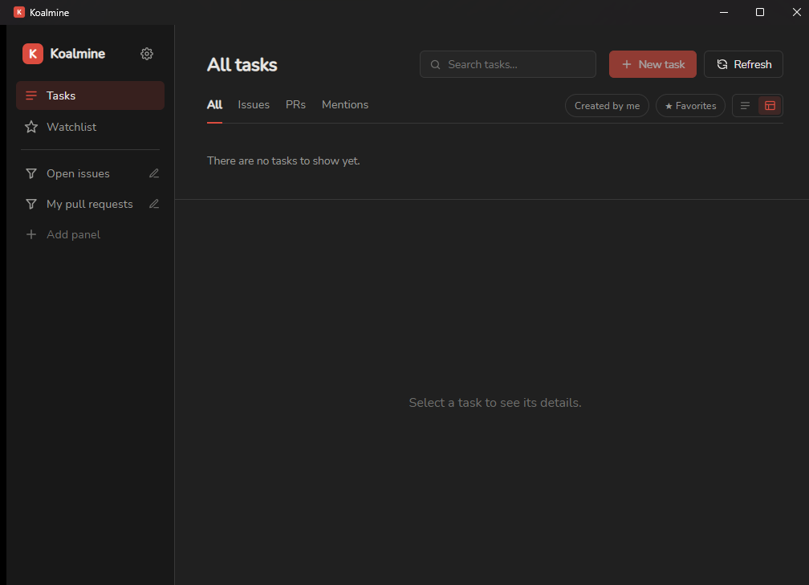
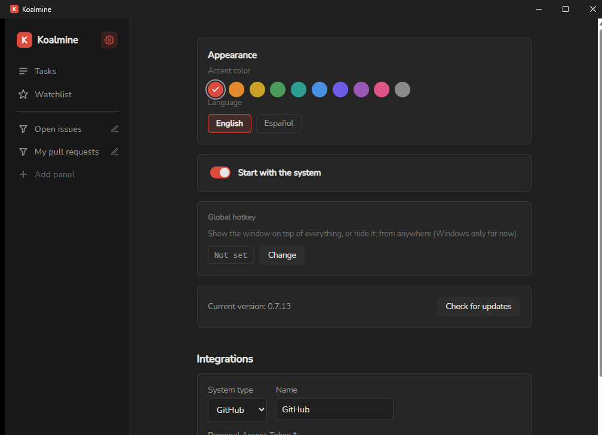
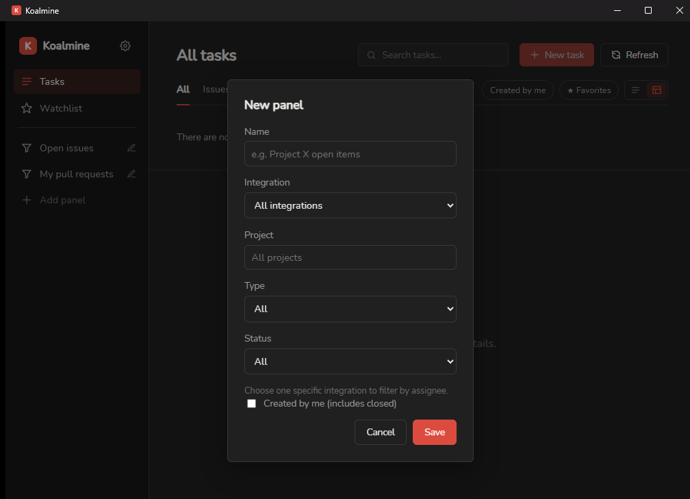
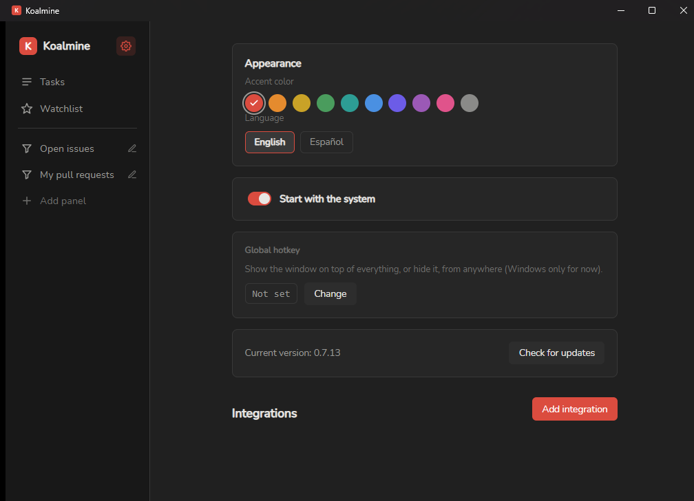

# Koalmine

Koalmine is a small Windows app that lives quietly in your system tray and
keeps track of your tasks across **Redmine, GitHub, GitLab, and Todoist** —
all in one window, instead of four browser tabs.

It checks your assigned items in the background and pops up a notification
when something new lands on your plate.

## Features

- **One inbox for everything.** See issues, pull/merge requests, and
  mentions from all your connected accounts in a single list.
- **Background notifications.** Koalmine polls every few minutes and lets
  you know when something new is assigned to you — no need to keep it open.
- **Custom panels.** Pin your own saved views to the sidebar — e.g. "Open
  issues in Project X" or "Everything I've created" — filtered by
  integration, project, type, status, or assignee.
- **Favorites / Watchlist.** Star anything you want to keep an eye on,
  regardless of which filter or panel it belongs to.
- **Search.** Quickly find a task by title across every connected account.
- **List or table view**, whichever you prefer for scanning your work.
- **Create tasks** directly from Koalmine without opening the browser.
- **A global shortcut** you can set yourself (e.g. `Ctrl+Shift+K`) that
  shows or hides the window from anywhere on your desktop, even while
  working in another app.
- **Starts with Windows** (optional) and **updates itself** — no manual
  reinstalling.
- Available in **English and Spanish**, with a handful of accent colors to
  match your taste.

## Installing

1. Go to the [Releases page](https://github.com/Fiambre/koalmine/releases)
   and download the latest `koalmine-windows-amd64-installer.exe`.
2. Run it and follow the prompts. It installs just for your own user
   account, so it doesn't need administrator rights.
3. Launch Koalmine from the Start Menu. It will add an icon to your system
   tray (near the clock) — that's where it lives from now on.

> **Note:** Windows may show an "unknown publisher" warning (SmartScreen)
> the first time you run the installer, since Koalmine isn't signed with a
> paid code-signing certificate yet. This is expected — if you downloaded
> it from the official Releases page above, it's safe to continue.

Once installed, Koalmine checks for new versions on its own and offers to
update itself from Settings — see [Staying up to date](#staying-up-to-date).

## Connecting your accounts

Open Koalmine, click the gear icon (⚙) in the top-left corner to open
**Settings**, then **Add integration** and pick a system:

### Redmine
- **Server URL** — your company's Redmine address (e.g.
  `https://redmine.yourcompany.com`).
- **API key** — found in Redmine under *My account → API access key*
  (click "Show" to reveal it).

### GitHub
- **Personal Access Token** — create one at
  [github.com/settings/tokens](https://github.com/settings/tokens) with
  read access to your repositories and issues.

### GitLab
- **Instance URL** — leave blank if you use gitlab.com, or enter your
  company's GitLab address.
- **Personal Access Token** — create one from your GitLab profile under
  *Access Tokens*, with `read_api` scope.

### Todoist
- **API Token** — found in Todoist under *Settings → Integrations →
  Developer*.

You can use "Test connection" before saving to make sure everything's set
up correctly, and connect as many accounts as you like (e.g. two different
GitLab instances) — just give each one a name you'll recognize.

## Using Koalmine

- **Tasks** shows everything currently assigned to you (or mentioning you),
  with tabs to narrow it down to Issues, PRs, or Mentions, and chips for
  "Created by me" and "Show closed".
- **Watchlist** shows only the items you've starred.
- **Custom panels** (the entries below Watchlist in the sidebar) are views
  you've built yourself — click **Add panel** to create one with its own
  filters, or the pencil icon next to a panel to edit it.

  
- Click any task to see its full description, comments, and a link to open
  it in your browser.
- Click the **+ New task** button to create an issue without leaving
  Koalmine.
- Use the search bar at the top to find something by title across every
  connected account.

### The global shortcut

In **Settings → Global hotkey**, click **Change** and press the key
combination you want to use (it needs at least one modifier key — Ctrl,
Alt, Shift, or the Windows key). From then on, pressing that combination
anywhere brings Koalmine to the front; pressing it again hides it. It's the
fastest way to check your tasks without reaching for the tray icon.

## Settings

- **Appearance** — pick an accent color and switch between English and
  Spanish.
- **Start with the system** — launches Koalmine automatically (minimized
  to the tray) when you log in to Windows.
- **Global hotkey** — set or clear your show/hide shortcut.
- **Integrations** — add, edit, test, or remove your connected accounts.

## Staying up to date

Koalmine checks for new versions on its own and shows a banner when one is
available. Click **Update now** and it downloads, installs, and restarts
itself automatically — no need to visit the Releases page unless you want
to read what changed. You can also check manually any time from
**Settings → Check for updates**.

## Privacy

Everything Koalmine knows about your tasks is stored only on your own
computer. API keys and tokens are kept in Windows' own Credential Manager
(the same secure storage your browser and other apps use for saved
passwords) — never in a plain text file, and never sent anywhere except
directly to the service you connected (Redmine, GitHub, GitLab, or
Todoist).

## Getting help

Found a bug, or have an idea for a feature? Open an issue on the
[GitHub repository](https://github.com/Fiambre/koalmine/issues).

---

*Koalmine is a free, open-source Windows desktop app. Currently
Windows-only.*
